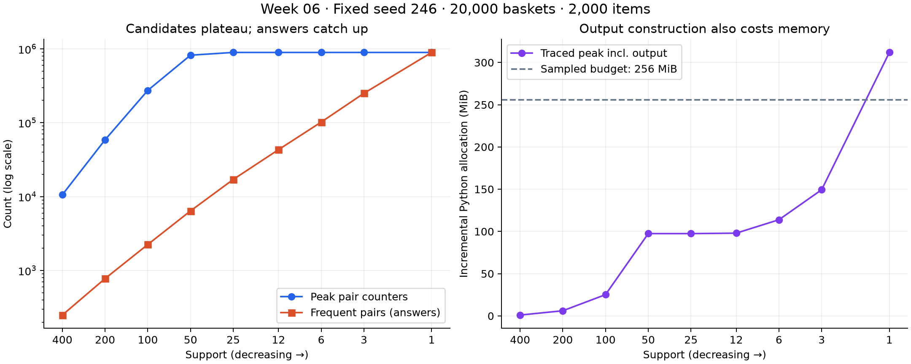

# Week 6 · Support 감소 실험

## 측정 환경과 범위

- CPU: Intel(R) Core(TM) i5-8500 CPU @ 3.00GHz (6 logical CPUs).
- RAM: 15.95 GiB; 마지막 batch 시작 시 여유 3.57 GiB.
- OS / Python: Windows-11-10.0.26200-SP0 / 3.12.14.
- 실행일: 2026-10-17 KST. CIM으로 ChatGPT, Notion, Claude, Codex, Windows Defender, Explorer, Steam WebHelper 실행을 확인했다. 다른 Codex 검증과 일부 겹쳤으므로 시간은 이 환경에서의 관측값이다.
- seed=246, 기본 20,000 baskets / 2,000 items / AVG=20. AVG는 생성기 파라미터로 실제 set 크기는 중복 제거로 더 작을 수 있다.
- 수정하지 않은 `PlainApriori`를 실행했다. 시간에는 tracemalloc 및 64개 바구니마다의 제한 확인이 포함되어 bench.txt 시간과 직접 비교하지 않는다.
- peak bytes는 입력 생성 후 추적한 Python 할당량이며 결과 딕셔너리도 포함한다. 기존 입력·인터프리터·native 메모리·tracemalloc 자체 비용을 포함한 RSS가 아니다.
- peak counters는 기준 구현의 pass-two 카운터 수이다. 반환 결과를 만드는 동안 카운터와 결과가 공존하는 메모리는 peak bytes에 반영되지만 counter 지표에는 추가되지 않는다.

## 기본 데이터: 같은 데이터에서 support만 변경

| Support | Frequent items | Peak counters | Frequent pairs | Counters / answers | Peak MiB | Seconds |
|---:|---:|---:|---:|---:|---:|---:|
| 400 | 146 | 10,585 | 249 | 42.51 | 1.01 | 0.941 |
| 200 | 345 | 58,626 | 776 | 75.55 | 6.09 | 1.615 |
| 100 | 825 | 273,701 | 2,244 | 121.97 | 25.17 | 2.587 |
| 50 | 1,849 | 820,259 | 6,397 | 128.23 | 97.44 | 4.464 |
| 25 | 2,000 | 893,456 | 17,045 | 52.42 | 97.44 | 4.911 |
| 12 | 2,000 | 893,456 | 43,116 | 20.72 | 97.96 | 5.167 |
| 6 | 2,000 | 893,456 | 101,938 | 8.76 | 113.83 | 6.209 |
| 3 | 2,000 | 893,456 | 250,054 | 3.57 | 149.34 | 6.324 |
| 1 | 2,000 | 893,456 | 893,456 | 1.00 | 311.88 | 7.728 |



### A4 · counter 증가는 선형이 아니며, 이 데이터에서는 결국 포화된다

| Support change | Counter multiplier | Answer multiplier |
|---|---:|---:|
| 400 → 200 | 5.539× | 3.116× |
| 200 → 100 | 4.669× | 2.892× |
| 100 → 50 | 2.997× | 2.851× |
| 50 → 25 | 1.089× | 2.665× |
| 25 → 12 | 1.000× | 2.530× |
| 12 → 6 | 1.000× | 2.364× |
| 6 → 3 | 1.000× | 2.453× |
| 3 → 1 | 1.000× | 3.573× |

400→200→100→50의 halving에서 counter는 약 5.54×, 4.67×, 3.00×로 늘었다. 그러나 support 25에서 모든 2,000개 항목이 살아남아 관측된 쌍 893,456개를 이미 전부 센다. 25→1에서는 counter가 더 증가하지 않는다. 이 고정 데이터에 무한한 explosion이나 OOM이 있다고 주장할 수 없다.

### A5 · 답과 counter는 다르게 증가한다

support 50에서는 820,259개 counter로 답 6,397개를 찾는다(128.23배). 400→200에서는 counter 5.54배, 답 3.12배로 낭비가 커진다. 반대로 25→1에서는 counter가 같아도 답은 17,045→893,456개(52.42배)로 늘어나고 support 1에서 모든 관측 쌍이 답이 된다. 따라서 답이 항상 더 천천히 자란다는 결론은 성립하지 않는다. 중간 support에서 적은 답을 얻기 위해 수십~수백 배의 후보를 보관하는 것이 문제다.

## A2 · 실제로 중단한 확장 실험

기본 데이터는 support 1까지 완료됐고 OS의 물리 메모리를 소진하지 않았다. support는 양의 정수라 더 낮출 수 없어, 별도 scale 실험을 했다. 같은 seed/생성기에서 60,000 baskets / 20,000 items / AVG=30으로 늘린 뒤 400부터 차례로 낮췄다. 두 크기의 행을 하나의 support 곡선으로 섞지 않았다.

실행 전 중단 예산을 새 Python 할당량 256 MiB 또는 실행 60초로 설정했다. 기존 앱의 RAM 사용을 고려해 선택한 작업 예산이며 OS 메모리의 절대 한계는 아니다. 검사는 바구니 사이에서만 하므로 dict resize와 최종 출력 생성 중에는 초과할 수 있다. 실제로 기본 support 1도 최종 출력 생성으로 311.9 MiB가 되어 예산보다 컸지만 완료됐다.

| Support | Status | Peak counters so far | Frequent pairs | Peak MiB | Seconds |
|---:|---|---:|---:|---:|---:|
| 400 | completed | 112,944 | 996 | 12.79 | 5.642 |
| 200 | completed | 560,800 | 2,824 | 51.30 | 7.830 |
| 100 | completed | 1,972,582 | 7,817 | 195.30 | 13.097 |
| 50 | stopped | 2,797,537 | 미완료 | 390.33 | 10.735 |

확장 데이터에서 처음 중단된 support는 **50**이다. pass 2의 24,960개 바구니 처리 후 counter 2,797,537개, 추적 peak 390.33 MiB, 10.73초에서 메모리 작업 예산을 초과해 중단했다. dict의 크기 확장 때문에 256 MiB보다 큰 값이 관측됐다. 시간 예산보다 메모리 예산이 먼저 걸렸으며, MemoryError나 시스템 전체 OOM은 발생하지 않았다. 미완료 행의 답 개수는 추정하지 않았다.

## 재현

```bash
python task2_explosion.py --supports 400,200,100,50,25,12,6,3,1 --max-mib 256 --max-seconds 60 --background "list your current apps"
python task2_explosion.py --items 20000 --baskets 60000 --avg 30 --supports 400,200,100,50,25,12,6,3,1 --max-mib 256 --max-seconds 60 --background "list your current apps"
python summarize_results.py
```

새 실행은 explosion.json에 batch ID와 함께 추가되며, 각 행이 끝날 때 저장된다. 재실행 시 중단 지점·시간·할당량은 달라질 수 있다. 원시 데이터는 explosion.json에 있다.
